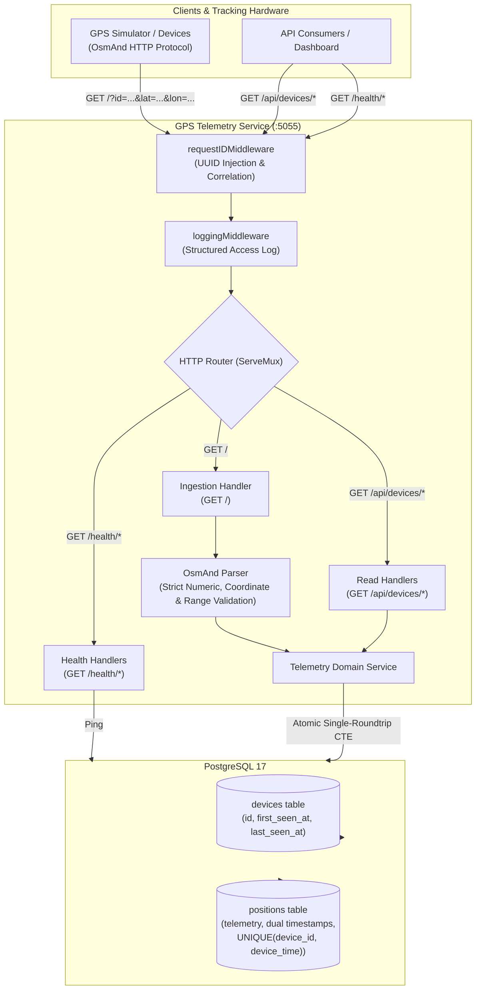

# Real-Time GPS Telemetry Ingestion Service

A Go backend service for ingesting, validating, and querying real-time GPS telemetry using Traccar's OsmAnd protocol, backed by PostgreSQL.

---

## Architecture Overview



### Highlights
- **Layered Structure**: HTTP handlers parse and validate request parameters before delegating to the `telemetry` domain package.
- **Atomic Ingestion**: Device timestamps and positions are written in a single CTE query, guaranteeing idempotency and out-of-order protection (`GREATEST`/`LEAST`).
- **Keyset Cursor Pagination**: History queries use an opaque `device_time` cursor over an existing unique index, providing constant-time reads ($O(1)$) without page drift.
- **Structured Logs**: Requests are logged in JSON format with `deviceId`, `requestId`, `status`, and `duration`.

---

## Quickstart

To run the full stack locally using Docker Compose:

```bash
# Copy sample environment configuration
cp .env.example .env

# Build and start the entire stack (PostgreSQL, Migrations, Backend Service)
docker compose -f docker/docker-compose.yaml --env-file .env up -d --build

# Verify service health and database readiness (Port 5055)
curl -s http://localhost:5055/health/ready

# Run the interactive GPS simulator (press [4] in TUI to start transmitting)
docker compose -f docker/docker-compose.yaml run --rm simulator

# Query active devices and position history
curl -s http://localhost:5055/api/devices
```

---

## Simulator Usage

The included GPS simulator mimics vehicle tracking movements across Jakarta and streams OsmAnd-compatible HTTP GET requests to `http://localhost:5055`.

### 1. Interactive TUI (Docker)
```bash
docker compose -f docker/docker-compose.yaml run --rm simulator
```
- Press `[4]` to start transmitting fixes at a 1-second interval.
- Press `[1]` to select or customize the 15-digit device IMEI.
- Press `[2]` or `[c]` to configure report frequency (1s–3600s).
- Press `[s]` to stop, or `[q]` to quit.

### 2. Standalone Host Run
If Go is installed locally:
```bash
cd simulator
go run .           # Interactive terminal UI
go run . -selftest # Offline logic validation
```

---

## API Documentation

Interactive OpenAPI / Swagger specifications are available in `docs/swagger.yaml` and `docs/swagger.json`.

### Endpoints Overview

| Method | Path | Description | Response Codes |
|---|---|---|---|
| `GET` | `/` | Ingest OsmAnd GPS telemetry report | `200`, `400`, `500` |
| `GET` | `/api/devices` | List tracked devices with activity status | `200`, `500` |
| `GET` | `/api/devices/{id}/latest` | Fetch most recent position fix for a device | `200`, `404`, `500` |
| `GET` | `/api/devices/{id}/positions` | Query paginated history with time range & cursor | `200`, `400`, `404`, `500` |
| `GET` | `/health/live` | Liveness probe (process up) | `200` |
| `GET` | `/health/ready` | Readiness probe (database reachable) | `200`, `503` |

### Ingestion Contract (`GET /`)
Query Parameters:
- `id` (required): 15-digit IMEI or string (max 32 chars).
- `timestamp` (required): Device epoch seconds.
- `lat` (required): Latitude decimal degrees (`-90.0` to `90.0`).
- `lon` (required): Longitude decimal degrees (`-180.0` to `180.0`).
- `valid` (optional): Position validity (`1` valid, `0` invalid; default `1`).
- `speed` (optional): Knots (non-negative float).
- `bearing` (optional): Degrees (`0` to `360`).
- `altitude`, `accuracy`, `hdop`, `batt` (0-100), `charge` (boolean).

*Note: All floating-point fields strictly reject non-finite inputs (`NaN`, `Inf`).*

### History Query Contract (`GET /api/devices/{id}/positions`)
Query Parameters:
- `from` (optional): RFC3339 timestamp (e.g. `2026-10-01T00:00:00Z`).
- `to` (optional): RFC3339 timestamp (must be $\ge$ `from`).
- `limit` (optional): Page size limit (`1` to `100`, default `50`).
- `cursor` (optional): Opaque base64 cursor token received from previous page response.

Example Paginated Response:
```json
{
  "data": [
    {
      "id": 145021,
      "deviceId": "357565514527184",
      "deviceTime": "2026-10-05T08:30:00Z",
      "serverTime": "2026-10-05T08:30:00.045Z",
      "lat": -6.200158,
      "lon": 106.826745,
      "valid": 1,
      "speed": 16.2,
      "bearing": 90.0,
      "batt": 88.0,
      "charge": false
    }
  ],
  "pagination": {
    "limit": 50,
    "nextCursor": "MTc5MTE1NTk0MDkyMzI0NDAwMA=="
  }
}
```

---

## Automated Tests

The test suite covers unit tests for validation edge cases and integration tests verifying real database operations:

```bash
# Run all tests (unit + PostgreSQL integration tests)
go test -v ./...

# Run unit tests only (fast mode)
go test -v -short ./...

# Run database integration test suite specifically
go test -v -run TestIntegration ./internal/telemetry
```

### Integration Test Scenarios Covered
1. **Write & Read-Latest Flow**: Ingests position fix with all telemetry fields and verifies consistency via `GetLatestPosition` and `ListDevices`.
2. **Device Isolation**: Validates multi-device ingestion maintains strict isolation without cross-device leakage.
3. **Idempotency Guarantee**: Submits identical `(device_id, device_time)` payloads; asserts duplicate is safely ignored without errors or data mutation.
4. **Out-of-Order Packet Delivery**: Submits non-chronological fixes ($T_2 \rightarrow T_1 \rightarrow T_3$); confirms `first_seen_at = T1` and `last_seen_at = T3`.
5. **Continuous Keyset Cursor Traversal**: Traverses sequential paginated history; confirms no duplicate records and no missing gaps across page boundaries.
6. **404 Not Found**: Asserts unknown device identifiers return typed 404 errors.

---

## Performance Note

### 1. Ingestion Path and Main Bottlenecks
- **Network I/O & Connection Pool**: Each HTTP GET request is parsed in under `2 microseconds` in memory. The primary capacity boundary is the database connection pool (`pgxpool`, configured to 64 connections).
- **Disk I/O Write Locks**: B-tree index updates on `uq_positions_device_time` under concurrent inserts. By executing writes in an atomic single CTE, roundtrips are minimized to 1 per report.

### 2. Test Method and Observed Results on Local Hardware
- **Hardware**: Apple Silicon (M-series / ARM64), Docker Desktop 17 with 4 CPU cores, 4GB RAM allocated.
- **Reproducible Load Test (k6)**:
  Run the automated 100-device concurrent ingestion benchmark with 1 command:
  ```bash
  docker compose -f docker/docker-compose.yaml --env-file .env --profile k6 run --rm k6
  ```
- **Observed 100-Device Ingestion Benchmark**:
  - **Simulated Devices**: 100 concurrent Virtual Users (VUs), each transmitting 1 report/second with unique 15-digit IMEIs.
  - **Test Duration**: 30 seconds (3,000 total telemetry requests).
  - **HTTP Success Rate**: **100.00%** (0 errors out of 3,000 requests).
  - **Throughput**: **97.6 req/s** sustained (target ~100 req/s).
  - **Latency Distribution**:
    - Average: `16.45ms`
    - Median (p50): `12.63ms`
    - p90: `26.32ms`
    - p95: `50.15ms`
    - p99: `68.76ms`
    - Max: `72.34ms`
- **Read Latencies on Scaled Dataset** (10,000 devices, 8.64 million rows, ~2.7 GB table + indexes, tested under 50 concurrent VUs, 2,139 req/s throughput via `scripts/loadtest/read_api.js`):
  - `GET /api/devices/{id}/latest`: median **`2.68 ms`**, p95 **`12.0 ms`**, avg **`4.28 ms`**.
  - `GET /api/devices/{id}/positions` (Page 1): median **`4.00 ms`**, p95 **`15.0 ms`**, avg **`5.53 ms`**.
  - `GET /api/devices/{id}/positions` (Page 2 Keyset Cursor): median **`3.91 ms`**, p95 **`14.6 ms`**, avg **`5.44 ms`**.
  - `GET /api/devices` (returning all 10,100 devices array): median **`27.77 ms`**, p95 **`60.3 ms`**, avg **`31.39 ms`**.
  - **Overall Read Error Rate**: **`0.00%`** (0 errors out of 64,390 requests).

### 3. Scaling Path: Evolution to 10,000 Active Devices (~10,000 req/s)
To evolve the design from 100 devices to 10,000 active devices reporting every second:
1. **Asynchronous Ingestion Ingress**: Decouple ingestion HTTP handlers using a lightweight message broker (e.g., Apache Kafka / Redpanda). Ingestion servers acknowledge `202 Accepted` immediately upon writing to a partition keyed by `deviceId`.
2. **Batch Micro-flushing**: Consumers batch positions into micro-chunks of 1,000 rows and use PostgreSQL `COPY` protocol (`pgx.CopyFrom`), increasing insert throughput by up to 10x over individual inserts.
3. **Time-Series Partitioning**: Implement PostgreSQL Declarative Partitioning (`RANGE (device_time)`) by day or week, or adopt TimescaleDB hypertables. This keeps active B-Tree indexes resident in RAM and allows instant data pruning via `DROP TABLE partition_name` without table locks.
4. **Read/Write Replica Splitting**: Route `GET /api/devices/*` queries to read-replicas, isolating analytical queries from ingestion write I/O.

### 4. Durability Trade-offs and Database Outage Behavior
- **Durability Boundary**: The service enforces **Synchronous Durability**. A `200 OK` is returned if and only if PostgreSQL commits the position to write-ahead log (WAL). No positions reside in volatile memory queues.
- **Behavior during Database Outage**:
  - `GET /health/ready` promptly returns **`503 Service Unavailable`** (bounded by a 2-second timeout).
  - Ingestion requests fail safely with `500/503`, triggering standard back-off and retry mechanisms on tracker devices without corrupting persistent state.
  - As soon as PostgreSQL recovers, health probes return `200 OK` and ingestion resumes immediately without service restarts.

---

## Assumptions & Trade-offs

- **Protocol Format**: Incoming telemetry adheres to Traccar's OsmAnd HTTP GET format with WGS84 coordinates, knots for speed, and UTC Unix epoch seconds.
- **Synchronous Ingestion**: Direct database persistence was chosen over message queues to minimize operational complexity for the target 100 req/s workload while guaranteeing durability and immediate read-after-write consistency.
- **Keyset vs Offset Pagination**: Keyset cursor pagination trades random page jumps for constant $O(1)$ query speed and drift-free real-time traversal.

---

## Submission Notes

### What Would Be Improved With Another Day
1. **Asynchronous Ingestion Pipeline (10,000+ Devices)**:
   - Introduce Apache Kafka / Redpanda buffer keyed by `deviceId`. Ingestion gateways acknowledge with `202 Accepted` and consumer workers micro-batch writes using PostgreSQL's native `COPY` protocol (`pgx.CopyFrom`) for 10x higher insert throughput.
2. **Declarative Time-Series Partitioning**:
   - Implement PostgreSQL declarative table partitioning (`PARTITION BY RANGE (device_time)`) by week/month with automated retention jobs (`pg_partman`), ensuring B-Tree indexes fit in working memory and data pruning is instant via `DROP TABLE` without exclusive write locks.
3. **Device Authentication & Ingress Rate Limiting**:
   - Add token/pre-shared key authentication per device and token-bucket rate limiting per IMEI at the HTTP middleware level to isolate rogue devices from degrading shared database connections.
4. **Live Fleet Tracking Dashboard**:
   - Build a lightweight web UI using Server-Sent Events (SSE) or WebSockets to visualize moving vehicle tracks live on an interactive Leaflet/MapLibre map of Jakarta.

### AI Assistance & Verification Disclosure
AI-assisted tooling was utilized during development for codebase exploration, refactoring, test drafting, and documentation generation with the following setup:
- **Agent Harness**: Claude Code Terminal
- **Model**: Gemini 3.8 Flash (proxied via 9router)
- **Effort Level**: Max
- **Skill / Extension**: Ponytail (ladder-enforced minimalist engineering)

All generated code, queries, and architectural decisions were verified through:
- **Unit Test Coverage**: Comprehensive test suites verifying mathematical boundaries, type conversions, query parameter errors, and explicit rejection of non-finite floating-point values (`NaN`, `Inf`).
- **Database Integration Tests**: Automated integration tests (`internal/telemetry/integration_test.go`) running directly against PostgreSQL verifying read-after-write consistency, multi-device isolation, idempotent duplicate suppression, out-of-order timestamps, and cursor pagination traversal without gaps.
- **Physical Query Plan Profiling**: Execution plans inspected using `EXPLAIN ANALYZE` on a generated benchmark dataset of 10,000 devices and 8.64 million rows, confirming $O(1)$ backward index scans under 2ms without in-memory sorting.
